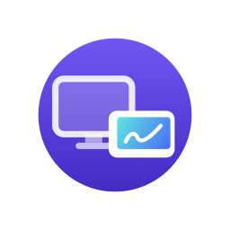

<p align="center"></p>

# Screenlet Companion

The Android app of Screenlet: it turns a tablet (made for the Samsung Galaxy
Tab and its S Pen) into a second display for your computer, over Wi-Fi or a
USB-C cable, with the lowest latency it can get. The computer runs
[Screenlet for macOS](https://github.com/DavideLoconte/Screenlet-macos),
[Screenlet for GNOME](https://github.com/DavideLoconte/Screenlet-linux) or
[Screenlet for Windows](https://github.com/DavideLoconte/Screenlet-windows); they
speak the [Screenlet protocol](PROTOCOL.md).

Screenlet started as a fork of
[Plus One](https://github.com/GabrieleSantangelo/PlusOne).

**A proof of concept, not ready for daily use.** The version is in [VERSION](VERSION).

## Features

- **Low latency.** Each frame goes to the hardware decoder (H.264 or HEVC)
  as soon as its packets are in, with no jitter buffer, and Wi-Fi runs
  without power saving while the desktop is shown.
- **Touch and S Pen.** Every finger and every pen sample, with pressure,
  tilt, hover and the barrel button, goes to the computer.
- **USB cable, network or Wi-Fi Direct.** Over the cable (Android Open
  Accessory) the app opens by itself, with no developer options; on the
  network it announces itself with mDNS; with no network to share, it runs a
  Wi-Fi Direct group the paired computer joins.
- **Only your computer.** Paired once by a six-digit code on both screens,
  TLS 1.3 on the link and AES-GCM on every video and input packet.

## Latency

- Packets are opened into buffers the app keeps, and each video packet is
  copied once, straight to its place in the frame: nothing allocated per packet.
- A whole frame goes straight into a free decoder buffer, decoded with every
  low-latency switch there is (Android's, Exynos', Qualcomm's, MediaTek's,
  the highest operating rate), and shown at the next vsync.
- The panel runs at its fastest refresh while the desktop is on screen.
- Receiving, the cable and the decoder's callbacks run at display priority.
- Touch and pen go out as the digitizer reports them, straight from the UI
  thread into a buffer kept for them: no allocation, no thread hop.

Each second the app measures five stages of every frame (capture to
decoded, to the first packet, the frame's spread over the network, the wait
for the decoder, the decoder) and sends them to the computer, which logs
them with its own ([PROTOCOL.md](PROTOCOL.md) §3.5).

## How it works

| Part | Implementation |
|---|---|
| Waiting for the computer | `CompanionService`: a foreground service, TLS server and mDNS (`_screenlet._tcp`) |
| Pairing | `Pairing.kt`, `Identity.kt` (Android Keystore, EC P-256) |
| Display | `DisplaySession`: AES-GCM packets in, MediaCodec out to a `SurfaceView` (`DisplayActivity`) |
| Touch and pen | `DisplayInput` |
| Cable | `UsbTunnel`: the computer's TLS connections and datagrams over one bulk stream each way |

## Build

Requires JDK 21 or later and the Android SDK (`ANDROID_HOME`, or
`local.properties` with `sdk.dir`).

```bash
./gradlew testDebugUnitTest lint assembleDebug     # app/build/outputs/apk/debug/app-debug.apk
adb install app/build/outputs/apk/debug/app-debug.apk
```

Measure latency with a release build, not the debug one: a debuggable app
runs every call into native code (decryption, for one) with checks, which
on a slow tablet costs several milliseconds a frame. `./gradlew
assembleShrunk` makes a release build signed with the debug key, which
installs over the debug one.

A release build (`assembleRelease`) is signed when `SCREENLET_KEYSTORE`,
`SCREENLET_KEYSTORE_PASSWORD` and optionally `SCREENLET_KEY_ALIAS` are set.
Dependencies are checked against `gradle/verification-metadata.xml`.
Without a JDK or SDK here, `DOCKER=podman tools/android-docker.sh testDebugUnitTest
assembleDebug` builds in a container. The unit tests check the shared protocol
vectors (`vectors.json`) and each step of the receive path, and print its cost
per packet. A `v*` tag publishes a release with the APK.

On first launch, allow the notifications (for the pairing code) and
"Display over other apps" (so the computer's desktop opens by itself).

## Future work

- A computer on KDE, speaking the same protocol.

## License

MIT, like Plus One. See [LICENSE](LICENSE).

## AI disclosure

Much of this code was written by Claude, Anthropic's AI model, through Claude Code, under
the author's direction. The author chose what to build and tested it on real hardware.
